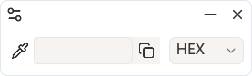
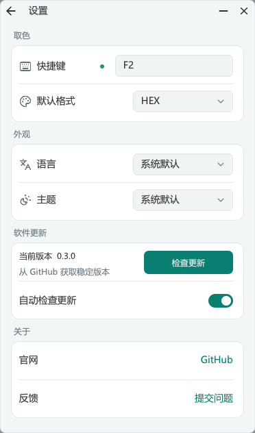

# Color Picker 取色器

按 `F2`，将放大镜对准桌面上的像素，单击即可把颜色值复制到剪贴板。Color Picker 使用 C17 和 CUI 实现，沿用旧版的置顶面板、滴管和历史色条。

[下载 Windows x64 便携版](https://github.com/Hunlongyu/color-picker/releases/latest/download/color-picker-x64.exe) · [v0.3.0 更新说明](https://github.com/Hunlongyu/color-picker/releases/tag/v0.3.0) · [问题反馈](https://github.com/Hunlongyu/color-picker/issues)

单个 EXE，无需安装；默认以管理员权限运行，配置与历史颜色保存在同目录的 INI 文件中。


## v0.3.0 更新

- 使用 C17 + CUI 重写，保留原来的应用 Logo、主面板布局和取色操作。
- 新增启动检查、手动检查、更新提示、更新说明、下载进度及校验后重启安装。
- 设置页按取色、外观、软件更新、关于分组；使用 CUI 输入框、下拉菜单和 Lucide SVG 操作图标。
- 语言与主题默认跟随系统，支持简体中文、English、浅色和深色；托盘常驻，显示面板也不占任务栏。
- 历史色块新增添加、移动和删除动画；空历史时收起色条，窗口宽度随颜色格式和输入内容调整。
- 优化快速移动时的放大镜绘制，修正「关于」列表悬浮背景及「检查更新」按钮文字垂直居中。

完整记录见 [更新日志](CHANGELOG.md)。

## 快速开始

1. 从 [GitHub Releases](https://github.com/Hunlongyu/color-picker/releases/latest) 下载 `color-picker-x64.exe`，无需下载安装包或源码压缩包。
2. 在 Windows 10（1803 或更高版本）或 Windows 11 x64 上，将 EXE 放入可写目录，双击并确认管理员权限提示即可运行。
3. 按 `F2` 开始取色。需要 RGB 时，从默认 HEX 连按两次 `C`，再单击确认。例如，`#112233` 会以 `rgb(17, 34, 51)` 复制。

从 v0.2.4 升级时，先退出旧版，再手动下载并运行新版。v0.3.0 使用同目录 INI 保存数据，不会自动导入旧版 Tauri 配置；后续版本可在软件内检查并安装更新。已有 CUI 便携版用户退出后替换 EXE 即可，保留原有 `color-picker.ini`。

Release 同时提供 `checksums.txt`。需要手动校验时，运行 `Get-FileHash .\color-picker-x64.exe -Algorithm SHA256`，将结果与校验文件中同名文件的值比较。

## 取色与历史

| 操作 | 结果 |
| --- | --- |
| 按全局快捷键（默认 `F2`）或单击滴管 | 定格当前桌面，打开放大镜 |
| 移动鼠标 / 按方向键 | 定位像素 / 每次微调一个像素 |
| 在放大镜中按 `C` | 按 HEX → HSL → RGB → CMYK → HWB → HEX 循环，预览待复制的值 |
| 单击左键或按 `Enter` | 复制当前格式的颜色值，并将该色移到历史首位 |
| 单击右键或按 `Esc` | 取消取色，恢复进入放大镜前的颜色及格式 |
| 单击 / 双击 / 右击历史色块 | 查看颜色值 / 复制颜色值 / 删除该色 |
| 编辑输入框后单击复制图标 | 复制编辑后的文字 |

放大镜直接读取定格桌面的像素缓存，先在后台缓冲区合成完整画面再显示。连续移动事件会合并，每帧采用最新鼠标位置，避免快速移动时逐个追赶旧位置或擦除闪烁。

历史色条最多保留 12 种颜色。新增色块会在约 240 毫秒内淡入并轻微放大，已有色块平滑让位。重复取色时，对应色块会滑到最前面。右键删除时，色块缩小淡出，后续色块平滑补位。

没有历史颜色时，主面板仅显示顶部操作栏和颜色值一行；首次取色后展开历史色条，删除最后一个色块并播完动画后自动收起。主面板宽度按当前颜色格式和输入内容调整，HEX 保持紧凑，较长的格式自动扩展；宽度上限按各格式最长值所需的空间计算。输入超长文字时，输入框内部滚动，窗口不再继续变宽。历史色块自动适应窗口宽度，设置与更新详情页保持原有宽度。



## 设置与托盘

- **快捷键与格式**　单击面板左上角设置图标，可修改全局快捷键和默认颜色格式。输入如 `Ctrl+Shift+P` 后按回车，绿点表示注册成功，红点表示按键无效或已被占用。主面板的格式选择对本次运行生效，设置页中的格式会保留到下次启动。
- **隐藏与恢复**　单击减号隐藏面板，隐藏后仍可用全局快捷键取色。左键单击托盘图标恢复面板；有更新时直接打开更新详情。程序始终使用托盘图标，面板显示时也不会占用任务栏按钮。单击面板右上角的关闭按钮会退出程序。
- **语言与主题**　设置页和托盘菜单均提供「系统默认 / 简体中文 / English」与「系统默认 / 浅色 / 深色」。新配置默认选择「系统默认」：中文 Windows 显示简体中文，其他系统语言使用 English；主题跟随 Windows 的应用浅色／深色模式，系统设置变化时自动刷新。手动选择会独立生效，已有 INI 中的选择会保留。
- **CUI 控件**　颜色值、快捷键输入框，以及格式、语言、主题下拉菜单均使用 CUI 组件，跟随主题，支持键盘操作。输入框支持文本选择、复制粘贴、撤销和中文输入；主面板的格式菜单会向下展开，关闭后恢复紧凑布局。
- **官网与反馈**　设置页底部的「关于」分组提供两行文字入口，点击整行即可打开项目官网或问题反馈页。
- **Logo 与界面图标**　程序和托盘保留旧版九宫格彩色 Logo；有更新时在托盘 Logo 上叠加提示点。界面内的操作图标使用 Lucide SVG，内嵌到 EXE，使用纯 C 的 NanoSVG 按 DPI 栅格化，再由 CUI 绘制，无需外置图标或运行库。



## 检查与安装更新

1. 默认在启动约 2 秒后静默检查 GitHub 稳定版，持续运行时每 24 小时再检查一次。设置页和托盘菜单的「自动检查更新」可以关闭此行为，已有 INI 中的选择会保留。
2. 发现新版时，主面板出现带提示点的下载图标，托盘图标也增加提示点。单击图标即可查看版本和更新说明；检查过程不会自动下载或重启。
3. 也可随时在设置页或托盘菜单点击「检查更新」。详情页会显示检查中、已是最新版本或错误信息，并提供重试入口。
4. 点击「下载更新」，查看进度条和百分比。服务端未返回文件长度时显示流动进度条。下载可取消，取消或校验失败会清除临时文件，之后可重新下载。
5. SHA-256 校验通过后，按钮变为「重启安装」。点击后由 updater 替换 EXE 并重启，保留同目录的 INI；重启后清理旧 EXE。安装失败会显示错误并允许重试。

更新说明使用 CUI 只读文本域，可选择、复制和滚动。没有可用稳定版发布信息、网络错误或附件缺失时，程序会显示对应状态；后台检查失败不会弹出对话框。

## 便携配置

修改设置或历史时，程序会写入 EXE 同目录的 `color-picker.ini`。迁移到另一台电脑时一起复制这两个文件，即可带走快捷键、默认格式、语言、主题和历史色。

以下示例将快捷键设为 `Ctrl+Shift+P`，启动格式设为 RGB，语言和主题跟随系统。也可以退出程序后直接编辑 INI，下次启动时生效。

```ini
[settings]
shortcut=Ctrl+Shift+P
format=RGB
language=system
theme=system
autoUpdate=1

[history]
colors=#112233,#FFFFFF
```

`language` 支持 `system`、`zh-CN`、`en`；`theme` 支持 `system`、`light`、`dark`。缺省时均采用 `system`。

## 从源码构建

需要 CMake 3.28 或更高版本，以及支持 C17 的 Windows x64 工具链。首次配置会下载 CMakeLists.txt 中固定提交的 CUI 和 updater 源码。

**MinGW-w64**（`gcc`、`windres` 和 `mingw32-make` 在 PATH 中）

```powershell
cmake -S . -B build -G "MinGW Makefiles" -DCMAKE_C_COMPILER=gcc -DCMAKE_RC_COMPILER=windres -DCMAKE_BUILD_TYPE=Release
cmake --build build --target color-picker --parallel
```

生成文件为 `build/color-picker-x64.exe`。

**Visual Studio**（安装 C++ 桌面开发工具和 Windows SDK）

```powershell
cmake -S . -B build-vs -A x64
cmake --build build-vs --config Release --target color-picker --parallel
```

生成文件为 `build-vs/Release/color-picker-x64.exe`。离线构建时，在配置命令中用 `-DFETCHCONTENT_SOURCE_DIR_CUI=<目录>` 和 `-DFETCHCONTENT_SOURCE_DIR_UPDATER=<目录>` 指向对应提交的本地源码。

## 发布自动更新

1. 修改 [CMakeLists.txt](CMakeLists.txt) 中的项目版本并重新构建。
2. 在 `Hunlongyu/color-picker` 创建稳定版 GitHub Release。标签与程序版本对应，例如程序版本 `0.3.1` 使用标签 `v0.3.1`。
3. 上传名为 `color-picker-x64.exe` 的附件。更新器按版本号选择新版，按文件名匹配附件，并校验 GitHub 提供的 SHA-256 摘要。可同时上传 `checksums.txt`，供 API 限流时的网页回退流程读取。
4. 在 Release 正文填写更新说明，这些内容会显示在软件的更新详情页。缺少有效 SHA-256 的附件不会进入安装流程。

发布附件只需 EXE 和校验文件，不附带个人 INI。先运行下方回归测试，再将对应源码提交打上版本标签，确保标签、EXE 内的版本号及 Release 一致。

### 验证取色、界面与更新闭环

MinGW 构建可启用集成测试。测试仅替换 HTTP 传输，实际使用 updater 的版本解析、SHA-256 校验、文件替换和重启逻辑；GUI 运行在隔离桌面，文件写入独立测试目录。

```powershell
cmake -S . -B build -DCOLOR_PICKER_BUILD_TESTS=ON
cmake --build build --target picker-flow update-flow update-payload --parallel
ctest --test-dir build -R '^(picker-flow|update-flow)$' --output-on-failure
```

覆盖空历史布局、首色展开与最后一色删除后收起、各格式自适应宽度与上限、CUI 输入、复制粘贴与撤销、鼠标及键盘下拉选择、快捷键提交、主题与语言切换、官网与反馈入口，以及静默检查、手动检查、提示图标、Unicode 更新说明、进度、取消、校验失败与重试、DPI 缩放、退出取消下载、真实 EXE 替换重启和 INI 保留。

取色回归使用模拟的 4K 桌面与鼠标位置，验证连续 5000 次移动只排队一帧、旧位置还原、像素颜色与放大方向、桌面边缘及跨屏坐标、DPI、C 键、方向键、点击与回车确认、取消和 GDI 资源释放，并输出绘制耗时。测试不会移动用户的鼠标，截图写入 `build/picker-qa`。

## 项目来源与许可

主面板布局及历史色交互沿用[旧版 Color Picker](https://github.com/Hunlongyu/color-picker/tree/00b72fe00252ef03e51cffd1214c48a3ecc67679)。界面使用 [CUI](https://github.com/yappologistic/CUI/tree/629b6fcb991d71527f2d67b25c51429c3dcdb498)，自动更新使用 [updater](https://github.com/Hunlongyu/updater/tree/b81aac54fe750247320ef82afc1d0ee4b3ce3162)。项目采用 [MIT 许可证](LICENSE)。

应用 Logo 沿用旧版项目的原始 ICO 文件。界面操作图标来自 [Lucide](https://github.com/lucide-icons/lucide/tree/03eae6069edfc373673bd05d723491f05ba936e3)，保留原始 SVG 和[许可声明](assets/lucide/LICENSE)。SVG 渲染使用 [NanoSVG](https://github.com/memononen/nanosvg/tree/239e102ec2c691f2902e20ace2ed36ee4a35cfe6)，采用 [zlib 许可证](third_party/nanosvg/LICENSE.txt)。第三方许可同时嵌入 EXE。
