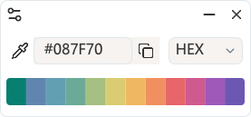

  

<h1 align="center">Color Picker</h1>

  A lightweight, native screen color picker for Windows.

  
  
  
  

  <b>English</b> · <a href="README.zh-CN.md">简体中文</a>

  

## ✨ Features

- **Instant Pixel Picking** — Press `F2` to freeze the screen, inspect pixels with the magnifier, and copy any color in a single click.
- **Multiple Color Formats** — Supports `HEX`, `RGB`, `HSL`, `CMYK`, and `HWB`. Press `C` while picking to cycle formats on the fly.
- **Smart Color History** — Keeps up to 12 recently picked colors with automatic deduplication for quick access.
- **Global Hotkey & Tray Mode** — Runs quietly in the system tray without occupying the taskbar. Pick colors anytime, even with the panel hidden.
- **Adaptive Appearance** — Supports Light and Dark modes as well as English and Simplified Chinese, following your system preferences by default.
- **Truly Portable** — A tiny, standalone `.exe` built in pure C. No installation or runtime required, with built-in update checks.

## 📦 Download

- **[Download Latest Portable EXE (Windows x64)](https://github.com/Hunlongyu/color-picker/releases/latest/download/color-picker-x64.exe)**
- Or browse all versions on **[GitHub Releases](https://github.com/Hunlongyu/color-picker/releases)**

> **Note:** No installation required. Place `color-picker-x64.exe` in any folder and run it directly on Windows 10 / 11 (x64).

## ⌨️ Controls

| Action | Description |
| :--- | :--- |
| `F2` *(customizable)* / Eyedropper | Open the screen magnifier to pick a color |
| `↑` `↓` `←` `→` | Fine-tune cursor position pixel by pixel |
| `C` | Cycle color format (`HEX` → `HSL` → `RGB` → `CMYK` → `HWB`) |
| `Left Click` / `Enter` | Copy color to clipboard and save to history |
| `Right Click` / `Esc` | Cancel color picking |
| **History Swatch** | **Click** to view · **Double-click** to copy · **Right-click** to delete |

## 📄 License

Released under the [MIT License](LICENSE).
