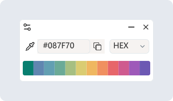

  

<h1 align="center">Color Picker 取色器</h1>

  轻量、纯粹的 Windows 桌面取色工具。 
  <b>~456 KB 单文件 · 免安装即用 · 毫秒级启动</b>

  
  
  
  
  

  <a href="README.md">English</a> · <b>简体中文</b>

  

## ✨ 功能特性

- **一键精准取色** — 按下 `F2` 定格屏幕并呼出放大镜，单击即可将目标像素颜色复制到剪贴板。
- **多种颜色格式** — 支持 `HEX`、`RGB`、`HSL`、`CMYK`、`HWB`，取色时按 `C` 键即可实时切换。
- **历史色板记录** — 自动保留最近 12 种颜色并智能去重，方便随时回看、复制或清理。
- **全局热键与托盘常驻** — 常驻系统托盘且不占用任务栏空间，隐藏主面板后依然可以随时快捷键取色。
- **浅色 / 深色主题** — 默认跟随系统的明暗主题与语言设置（简体中文 / English），也支持手动切换。
- **~456 KB 单文件免安装** — 纯 C 原生构建，无任何外部运行时依赖。仅单个 `.exe` 文件，体积不到 500 KB，内存占用极低，双击即用。

## 📦 下载使用

- **[下载最新便携版 color-picker-x64.exe（~456 KB 单文件免安装）](https://github.com/Hunlongyu/color-picker/releases/latest/download/color-picker-x64.exe)**
- 或前往 **[GitHub Releases](https://github.com/Hunlongyu/color-picker/releases)** 查看所有版本

> **提示：** 无需安装或配置运行库，在 Windows 10 / 11 (x64) 下下载 `color-picker-x64.exe` 双击即可运行。

## ⌨️ 快捷操作

| 操作 | 说明 |
| :--- | :--- |
| `F2`（可自定义）/ 点击滴管 | 开启屏幕放大镜取色 |
| `↑` `↓` `←` `→` 方向键 | 取色时逐像素微调准星位置 |
| `C` | 取色时循环切换颜色格式（`HEX` → `HSL` → `RGB` → `CMYK` → `HWB`） |
| `左键单击` / `Enter` | 确认取色并复制到剪贴板 |
| `右键单击` / `Esc` | 取消本次取色 |
| **历史色块操作** | **单击**查看颜色值 · **双击**复制颜色值 · **右键**删除该颜色 |

## 📄 开源协议

基于 [MIT License](LICENSE) 开源发布。
